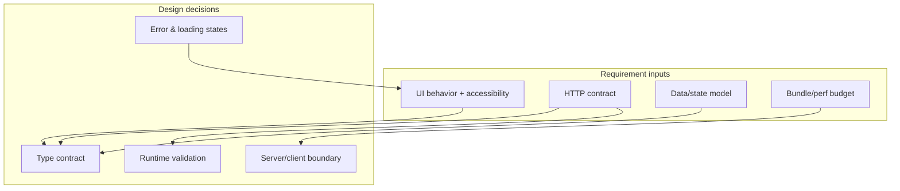
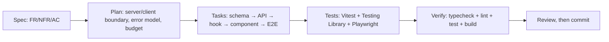
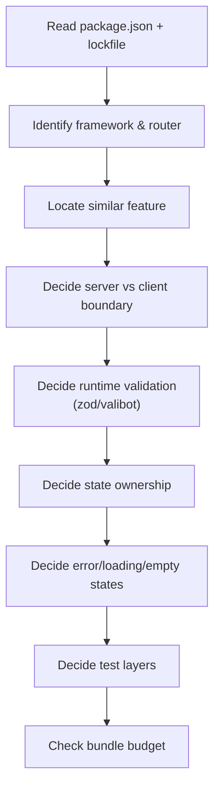
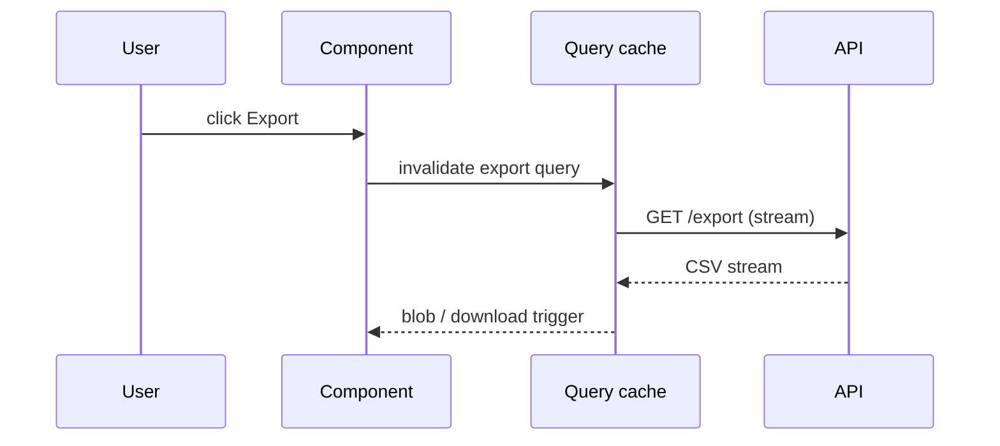
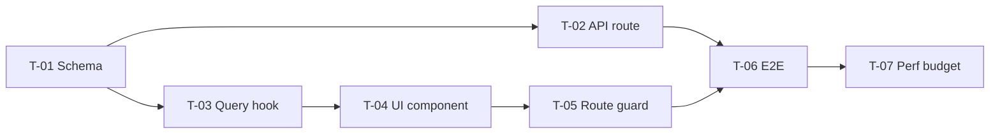
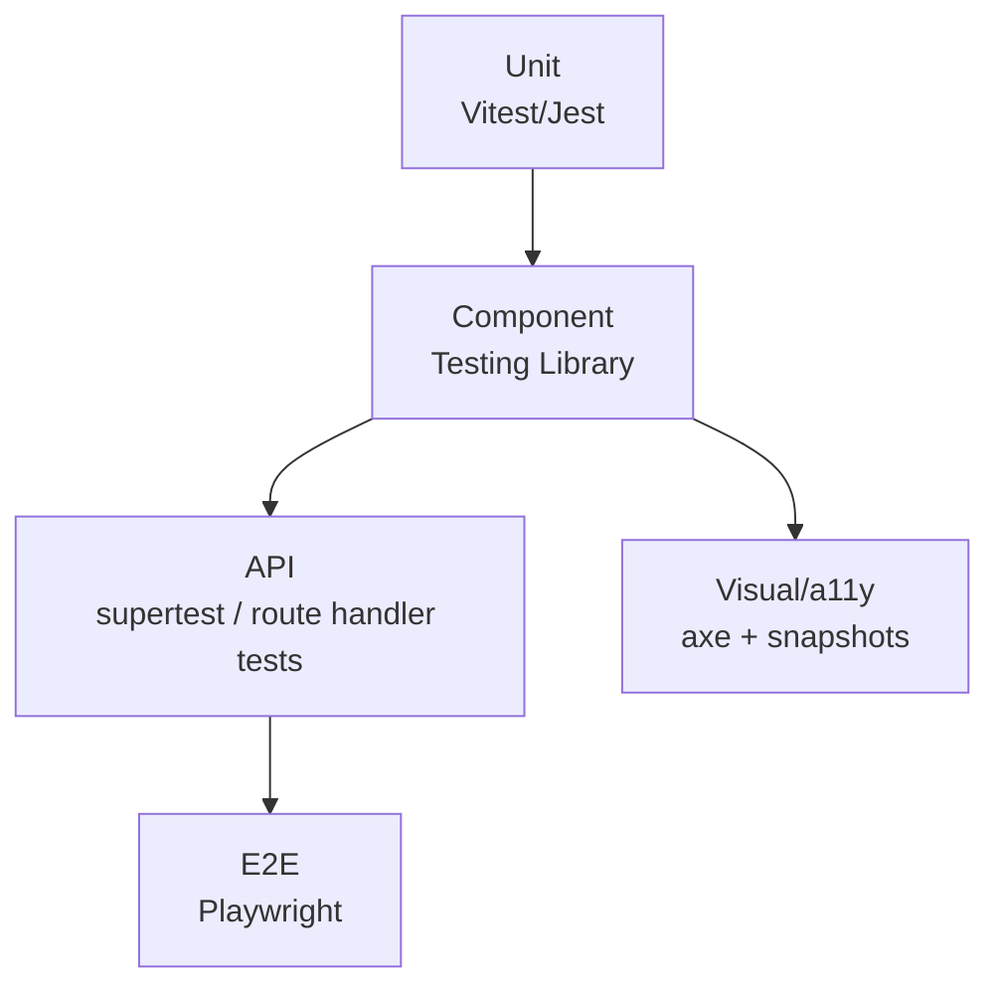
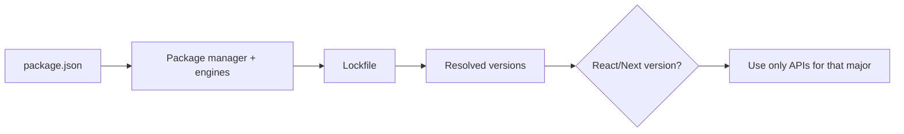
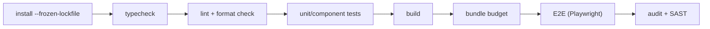

# JavaScript / TypeScript — SDD Guide

> Runtime data verified 2026-11-02 (`endoflife.date`): **Node.js 26 is the current LTS**;
> 24 and 22 remain supported. Node 20 reached end of life on 2026-04-30.

---

## 1. Scope

Node.js, npm/pnpm/yarn, TypeScript, React, Next.js, NestJS, Express, Jest and Vitest,
Playwright, ESLint, and type-checking as a gate.



---

## 2. Runtime and tooling contract

| Requirement | Must state |
| --- | --- |
| Node version | `engines.node`, `.nvmrc`, or CI matrix |
| Package manager | Exactly one, with committed lockfile |
| TypeScript | `strict: true`; `noUncheckedIndexedAccess` recommended |
| Module system | ESM vs CJS, per package |
| Build output | Bundler and target |

`package.json` (illustrative):

```json
{
  "name": "@acme/orders-web",
  "type": "module",
  "engines": { "node": ">=24 <27" },
  "packageManager": "pnpm@10",
  "scripts": {
    "build": "tsc -p tsconfig.build.json && vite build",
    "test": "vitest run",
    "typecheck": "tsc --noEmit",
    "lint": "eslint .",
    "e2e": "playwright test"
  }
}
```

> **`packageManager` + lockfile are the contract.** If two lockfiles exist (npm + pnpm), the
> repository has a defect — report it before adding dependencies.

---

## 3. Adopting SDD in a JavaScript / TypeScript project

### 3.1 Verify the toolchain

```bash
node --version
pnpm --version                    # or npm / yarn — exactly one
pnpm install --frozen-lockfile    # fails when the lockfile is out of date (good)
pnpm run typecheck
```

If the repository has more than one lockfile, stop and report it. Two package managers produce two
dependency graphs, and the agent will read the wrong one.

### 3.2 Add the agent rules

`AGENTS.md` (plus `.github/copilot-instructions.md` for Visual Studio and JetBrains — see
[chapter 29](../docs/29-ide-setup.md)):

```markdown
## TypeScript rules
- `strict` is on; no new `any` without a comment explaining why.
- Authorization is enforced server-side; UI checks are UX only.
- Every component behavior change needs a Testing Library test using role/name queries.
- Every API route change needs a handler test with a mocked session.
- No dependency for something the platform provides.
- Bundle budget per route group is enforced in CI.
```

### 3.3 Your first SDD change



### 3.4 Verification commands

| Check | Command |
| --- | --- |
| Types | `pnpm run typecheck` |
| Lint and format | `pnpm run lint` / `pnpm exec prettier --check .` |
| Unit and component tests | `pnpm run test` |
| Build and bundle budget | `pnpm run build` |
| E2E | `pnpm exec playwright test` |
| Dependencies | `pnpm audit --prod` |

### 3.5 Adoption pitfalls

| Pitfall | Fix |
| --- | --- |
| Authorization implemented in the UI only | State server-side enforcement in the spec |
| `any` added to silence the compiler | `unknown` + narrowing, or fix the type |
| Snapshot tests as the only coverage | Assert roles, text, and network behavior |
| Unpinned Playwright browsers | Pin the version and cache in CI |

---

## 4. Writing requirements

### 3.1 TypeScript-specific additions

| Universal requirement | TypeScript addition |
| --- | --- |
| Functional behavior | Component/route/endpoint and state ownership |
| Acceptance criteria | DOM/ARIA assertion, HTTP response, or function output |
| NFRs | LCP/INP/CLS budgets, bundle size, p95 API latency |
| Failure scenarios | Error boundary, retry, offline state, empty state |
| Compatibility | Browsers, React/Next versions, public type exports |

### 3.2 Example — UI

```markdown
### FR-7: Order export button respects permissions

**Acceptance criteria**
- AC-7.1 Given a user with `viewer`, the Export button is visible and enabled.
- AC-7.2 Given a user without a role, the button is absent and the route
  `/projects/:id/export` renders the `Forbidden` page (no data request is made).
- AC-7.3 While exporting, the button shows `aria-busy="true"` and is keyboard-focusable
  but disabled; a live region announces "Preparing export".
- AC-7.4 If the request fails with `403`, the UI shows an error toast and does not retry.
- AC-7.5 Bundle size for the route group increases by ≤ 15 kB gzip.

**Non-goals**
- Client-side CSV generation; all export happens server-side.
```

### 3.3 Example — API

```markdown
### FR-8: `GET /api/projects/:id/orders/export`

**Acceptance criteria**
- AC-8.1 Returns `200` with `content-type: text/csv; charset=utf-8`.
- AC-8.2 Missing/invalid session returns `401`; no role returns `403` with
  `{ "error": { "code": "forbidden" } }`.
- AC-8.3 Rows match `GET /api/projects/:id/orders` for the same filters.
```

---

## 5. Technical plan



### Plan template additions

````markdown
## Boundaries
| Concern | Server | Client |
| --- | --- | --- |
| Authorization | ✅ | UI hint only (never the control) |
| CSV generation | ✅ | — |
| Filtering state | — | URL search params |
| Validation | zod schema shared | same schema |

## Data flow


## Error model
| Status | UI behavior |
| --- | --- |
| 401 | Redirect to login |
| 403 | Forbidden page, no retry |
| 5xx | Toast + retry button (max 1) |

## Bundle budget
Route group budget: +15 kB gzip. Measured by the existing bundle analyzer in CI.
````

> The nested `mermaid` block above must be inside a four-backtick fence when you copy it into
> your own plan file.

---

## 6. Task division

| Task | Files | Parallelizable |
| --- | --- | --- |
| Shared zod schema + tests | `packages/shared/` | Yes |
| API route + handler tests | `apps/api/` | After schema |
| Query/mutation hook | `apps/web/src/queries/` | Yes |
| UI component + a11y tests | `apps/web/src/components/` | Yes |
| Route guard | `apps/web/src/routes/` | After hook |
| E2E scenario | `e2e/` | After all |
| Bundle budget check | CI config | After build |



**Definition of done:**

- [ ] `tsc --noEmit` passes
- [ ] ESLint passes with zero warnings
- [ ] Unit/component tests pass
- [ ] No `any` introduced without a comment justifying it
- [ ] Empty/loading/error states implemented
- [ ] Keyboard + screen-reader assertions for interactive UI
- [ ] Bundle budget respected

---

## 7. Specifying tests



### Component test with accessibility assertions

```tsx
import { render, screen } from "@testing-library/react";
import userEvent from "@testing-library/user-event";
import { expect, test } from "vitest";
import { ExportButton } from "./ExportButton";

test("AC-7.3: exporting announces busy state and disables the button", async () => {
  const user = userEvent.setup();
  render(<ExportButton projectId="p1" />);

  const button = screen.getByRole("button", { name: /export/i });
  await user.click(button);

  expect(button).toHaveAttribute("aria-busy", "true");
  expect(button).toBeDisabled();
  expect(screen.getByRole("status")).toHaveTextContent(/preparing export/i);
});
```

### Playwright E2E

```ts
import { test, expect } from "@playwright/test";

test("AC-7.2: user without role sees Forbidden and no data request", async ({ page }) => {
  const requests: string[] = [];
  page.on("request", (r) => requests.push(r.url()));

  await page.goto("/projects/p2/export");

  await expect(page.getByRole("heading", { name: /forbidden/i })).toBeVisible();
  expect(requests.some((u) => u.includes("/orders/export"))).toBe(false);
});
```

| Requirement type | Minimum evidence |
| --- | --- |
| Pure logic | Unit test |
| Component behavior | Testing Library + user-event |
| Accessibility | Role/name queries; axe check |
| API route | Handler test with a mocked session |
| Cross-page flow | One Playwright test per critical journey |
| Perf budget | Bundle analyzer / Lighthouse CI |

> **Snapshot tests are weak evidence.** Prefer explicit assertions on roles, text, and network
> behavior; use snapshots only for stable, intentionally visual output.

---

## 8. How the agent inspects existing code

```bash
# Package manager and versions
ls -la package.json pnpm-lock.yaml package-lock.json yarn.lock 2>/dev/null
node -p "require('./package.json').packageManager"
pnpm list --depth 1 2>/dev/null | head -30

# Framework and routing
grep -rn --include='*.ts' --include='*.tsx' 'createBrowserRouter\|app/\|pages/' src | head -20
grep -rn --include='*.ts' --include='*.tsx' 'useQuery\|useSWR\|createAsyncThunk' src | head -20

# Validation and types
grep -rn --include='*.ts' --include='*.tsx' 'z.object\|yup\.\|valibot' src | head -20
grep -rn --include='*.ts' --include='*.tsx' '\bany\b' src | head -20

# Tests
find . -name '*.test.ts' -o -name '*.test.tsx' -o -name '*.spec.ts' | head -30
```



Checklist:

- [ ] Node version and package manager identified
- [ ] Framework major version read from the lockfile
- [ ] TypeScript strictness read from `tsconfig.json`
- [ ] Existing data-fetching pattern identified
- [ ] Test runner and config located
- [ ] Build tool and bundle budget mechanism located

---

## 9. Code review focus

| Area | Question |
| --- | --- |
| Types | New `any`? Unsafe casts? `as unknown as T`? |
| Server/client | Secrets or DB code imported into client bundle? |
| Auth | Is authorization enforced server-side? |
| Rendering | Unnecessary `"use client"`? Waterfall requests? |
| Effects | `useEffect` used for derived state? Missing cleanup? |
| State | Duplicated server state in client stores? |
| XSS | `dangerouslySetInnerHTML` with untrusted input? |
| A11y | Keyboard path, focus management, labels |
| Performance | New large dependency? Bundle regression? |
| Errors | Unhandled promise rejection? Error boundary? |

**High-severity JS/TS findings:**

- Authorization decided only in the UI.
- `dangerouslySetInnerHTML` with user data.
- `eval`, `new Function`, or dynamic `import()` of user input.
- Secrets referenced with `NEXT_PUBLIC_` / `VITE_` prefixes.
- `npm install` in CI instead of a frozen lockfile.

---

## 10. Static analysis and tooling

| Tool | Purpose | Invocation |
| --- | --- | --- |
| **TypeScript** | Type checking | `tsc --noEmit` |
| **ESLint** | Lint + framework rules | `eslint .` |
| **Prettier** | Formatting (or Biome) | `prettier --check .` |
| **Vitest / Jest** | Unit tests | `vitest run` / `jest` |
| **Testing Library** | Component behavior | library |
| **Playwright** | E2E + tracing | `playwright test` |
| **axe-core** | Accessibility | `@axe-core/playwright` |
| **Lighthouse CI** | Perf budgets | `lhci autorun` |
| **npm audit / pnpm audit** | Dependency CVEs | `pnpm audit --prod` |
| **Trivy** | FS/image/secrets | `trivy fs .` |
| **Semgrep / CodeQL** | SAST | CI step |

```bash
pnpm install --frozen-lockfile
pnpm run typecheck
pnpm run lint
pnpm run test
pnpm run build
pnpm audit --prod
```

---

## 11. CI verification



```yaml
# .github/workflows/web-ci.yml (illustrative)
name: web-ci
on: [push, pull_request]
jobs:
  verify:
    runs-on: ubuntu-latest
    steps:
      - uses: actions/checkout@v4
      - uses: pnpm/action-setup@v4
        with: { version: 10 }
      - uses: actions/setup-node@v4
        with: { node-version: '24', cache: 'pnpm' }
      - run: pnpm install --frozen-lockfile
      - run: pnpm run typecheck
      - run: pnpm run lint
      - run: pnpm run test
      - run: pnpm run build
      - run: pnpm exec playwright install --with-deps
      - run: pnpm run e2e
```

| Gate | Fails when |
| --- | --- |
| Install | Lockfile out of sync |
| Typecheck | Any error |
| Lint | Any error or warning above the policy |
| Tests | Any failure |
| Build | Build error |
| Bundle | Budget exceeded |
| E2E | Critical journey fails |

---

## 12. Common mistakes

| Mistake | Consequence | Fix |
| --- | --- | --- |
| Multiple lockfiles | Non-reproducible installs | One package manager |
| `npm install` in CI | Silent lockfile drift | `--frozen-lockfile` / `npm ci` |
| `any` to silence errors | Hidden runtime bugs | `unknown` + narrowing |
| Authorization only in UI | Data leak | Server-side enforcement |
| Overusing `"use client"` | Bundle bloat, waterfalls | Keep components server-first |
| `useEffect` for derived data | Extra renders, bugs | Compute during render |
| Missing `key` or index keys | State bugs on reorder | Stable IDs |
| Unpinned Playwright browsers | CI drift | Pin version; cache |
| Snapshot-only tests | False confidence | Behavior assertions |
| Large dependency for one function | Bundle regression | Check platform APIs first |

---

## 13. Troubleshooting

| Symptom | Cause | Action |
| --- | --- | --- |
| `ERR_PNPM_OUTDATED_LOCKFILE` | `package.json` changed without lock | `pnpm install`, commit lockfile |
| Type errors only in CI | Different TS version or project refs | Pin TypeScript; build all projects |
| Hydration mismatch (Next) | Server/client divergence | Move dynamic values to effects or `suppressHydrationWarning` only when justified |
| Playwright fails in CI only | Missing browser deps | `playwright install --with-deps` |
| CI OOM | Parallel workers | Reduce workers; cache |
| ESM/CJS errors | Mixed module systems | Align `type`, `exports`, and bundler |
| Flaky component test | Async state not awaited | Use `findBy*`/`waitFor` |
| Bundle grew unexpectedly | Barrel imports / heavy dep | Analyze with the bundle analyzer |

---

## 14. Security considerations

| Risk | Control |
| --- | --- |
| XSS | Avoid `dangerouslySetInnerHTML`; sanitize if unavoidable |
| Client-side secrets | Only server env vars; never `NEXT_PUBLIC_*` for secrets |
| CSRF | SameSite cookies + token for state-changing requests |
| Open redirects | Allow-list redirect targets |
| Prototype pollution | Validate/limit object merges from user input |
| Dependency supply chain | Lockfile, provenance, `pnpm audit`, Trivy |
| Third-party scripts | CSP with nonces; no inline scripts |
| SSRF via fetch proxy | Allow-list destinations server-side |

---

## 15. Official references

- Node.js releases — <https://nodejs.org/en/about/previous-releases>
- Node.js support — <https://github.com/nodejs/Release>
- TypeScript — <https://www.typescriptlang.org/docs/>
- pnpm — <https://pnpm.io/motivation>
- npm — <https://docs.npmjs.com/>
- React — <https://react.dev/>
- Next.js — <https://nextjs.org/docs>
- NestJS — <https://docs.nestjs.com/>
- Express — <https://expressjs.com/>
- Vitest — <https://vitest.dev/>
- Jest — <https://jestjs.io/docs/getting-started>
- Testing Library — <https://testing-library.com/docs/>
- Playwright — <https://playwright.dev/docs/intro>
- ESLint — <https://eslint.org/docs/latest/>
- Prettier — <https://prettier.io/docs/>
- Lighthouse CI — <https://github.com/GoogleChrome/lighthouse-ci>

---

**Previous:** [.NET / C#](./dotnet-csharp.md) ·
**Next:** [Go](./go.md) ·
**Back to index:** [00-index.md](../docs/00-index.md)
