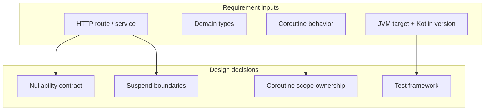
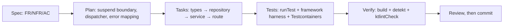
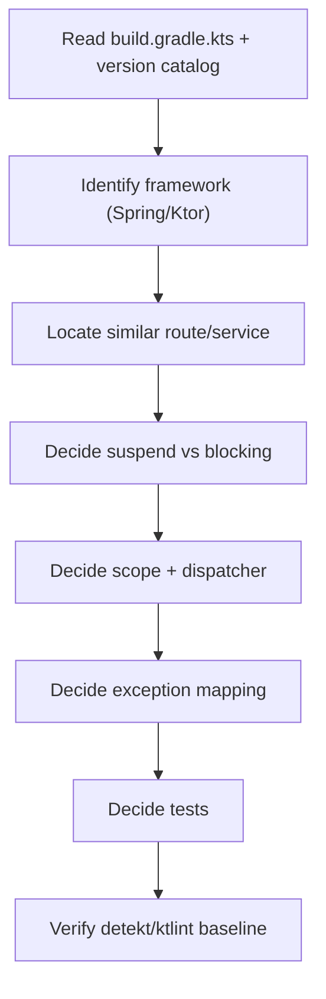
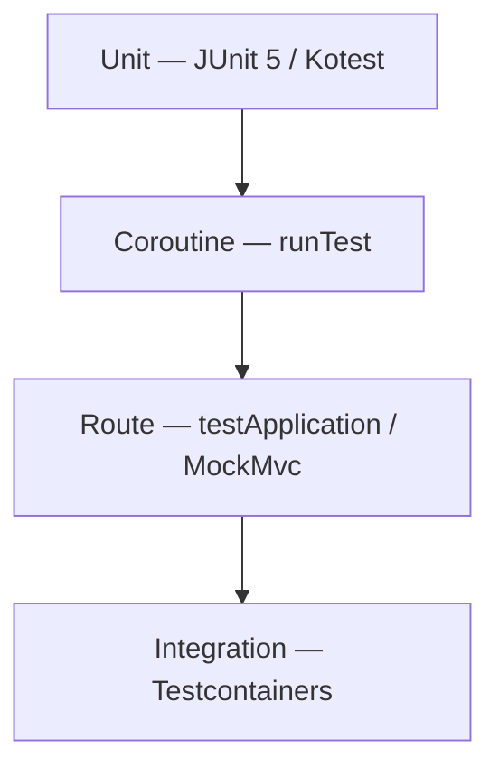
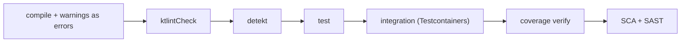

# Kotlin — SDD Guide

> Version data verified 2026-11-02 (`endoflife.date`): Kotlin **2.4.x** was current. Kotlin has
> no LTS line; align the compiler with the Gradle/AGP versions your project supports.

---

## 1. Scope

Gradle Kotlin DSL, coroutines, Spring Boot (Kotlin), Ktor, JUnit 5/Kotest, detekt, ktlint,
nullability, and multiplatform concerns.



---

## 2. Toolchain contract

| Requirement | Must state |
| --- | --- |
| Kotlin version | e.g. `2.4.x` |
| JVM target | e.g. `21` |
| Gradle wrapper | `./gradlew` version pinned |
| Coroutines version | From the dependency catalog |
| Compiler flags | `-Werror`, explicit API mode for libraries |

```kotlin
// build.gradle.kts (illustrative)
kotlin {
    jvmToolchain(21)
    compilerOptions {
        allWarningsAsErrors.set(true)
        freeCompilerArgs.add("-Xjsr305=strict")
    }
}

tasks.withType<Test> { useJUnitPlatform() }
```

> **`allWarningsAsErrors` is a requirement, not a preference.** Without it, deprecation warnings
> accumulate silently and an agent will happily build on deprecated APIs.

---

## 3. Adopting SDD in a Kotlin project

### 3.1 Verify the toolchain

```bash
./gradlew -version
./gradlew build -x test
./gradlew test
```

Pin the Gradle wrapper and the Kotlin/JVM target before adoption. Without them, the agent compiles
against a different stdlib than the deployment runtime.

### 3.2 Add the agent rules

`AGENTS.md` (plus `.github/copilot-instructions.md` for Visual Studio and JetBrains — see
[chapter 29](../docs/29-ide-setup.md)):

```markdown
## Kotlin rules
- No `!!` in production code; handle the null case.
- Never swallow `CancellationException`; rethrow it.
- Blocking work goes on `Dispatchers.IO`, never `Dispatchers.Default`.
- No `GlobalScope`; use the request scope.
- New routes are `suspend`; exceptions map to status codes in one place.
- detekt and ktlint must pass with zero findings.
```

### 3.3 Your first SDD change



### 3.4 Verification commands

| Check | Command |
| --- | --- |
| Build (warnings as errors) | `./gradlew build` |
| Formatting | `./gradlew ktlintCheck` |
| Static analysis | `./gradlew detekt` |
| Tests | `./gradlew test` |
| Coverage | `./gradlew koverVerify` |

### 3.5 Adoption pitfalls

| Pitfall | Fix |
| --- | --- |
| `!!` added to satisfy the compiler | Nullability rules in `AGENTS.md` |
| Blocking JDBC on `Dispatchers.Default` | Specify the dispatcher in the plan |
| `GlobalScope.launch` in a route | Structured concurrency rule |
| detekt baseline silently updated | Review baseline changes like code |

---

## 4. Writing requirements

| Universal requirement | Kotlin addition |
| --- | --- |
| Functional behavior | Route/handler, suspend vs blocking boundary |
| Acceptance criteria | Status/body, `Result` variant, coroutine completion |
| NFRs | p95 latency, dispatcher choice, cancellation latency |
| Failure scenarios | Exception mapping, `CancellationException` propagation |
| Compatibility | JVM target, public API mode, coroutines version |

```markdown
### FR-9: Export endpoint (Ktor)

**Acceptance criteria**
- AC-9.1 `GET /projects/{id}/orders/export` returns `200` with `text/csv`.
- AC-9.2 Missing role returns `403` and no CSV bytes.
- AC-9.3 The route is `suspend` and never blocks a dispatcher thread on JDBC; the blocking
  query runs on `Dispatchers.IO`.
- AC-9.4 Client disconnect cancels the export within 200 ms (`CancellationException`
  observed once, not logged as an error).
- AC-9.5 No `!!` operator introduced in production code.

**Non-goals**
- Compression; background export.
```

### Nullability and cancellation rules

| Rule | Why |
| --- | --- |
| No `!!` in production code | Converts a type error into a runtime crash |
| `CancellationException` must be rethrown | Swallowing it breaks structured concurrency |
| No `GlobalScope` | Unstructured work outlives the request |
| Explicit dispatcher for blocking work | Prevents event-loop starvation |
| `Flow` for streams, `suspend` for one-shot | Clear semantics |

---

## 5. Technical plan



### Plan additions

```markdown
## Module impact
| Module | Change |
| --- | --- |
| `:api` | Route |
| `:core` | Export service |
| `:persistence` | Query |

## Coroutines
- Route is `suspend`; blocking JDBC wrapped in `withContext(Dispatchers.IO)`.
- No new `CoroutineScope`; use the request scope.
- Cancellation is cooperative: check `ensureActive()` in loops.

## Errors
| Exception | Status |
| --- | --- |
| `ForbiddenException` | 403 |
| `NotFoundException` | 404 |
| `SQLException` | 500 (logged, generic body) |

## Tests
- Unit: CSV encoder (JUnit 5 + AssertJ)
- Route: Ktor `testApplication` or Spring `@WebMvcTest`
- Integration: Testcontainers Postgres
- Coroutine: `runTest` with `TestDispatcher`
```

---

## 6. Task division

| Task | Files | Parallelizable |
| --- | --- | --- |
| Domain types | `:core/domain` | Yes |
| CSV encoder + tests | `:core/export` | Yes |
| Persistence query | `:persistence` | Yes |
| Service orchestration | `:core/service` | After encoder + repo |
| Route + status mapping | `:api` | After service |
| Integration test | `:api/src/test` | After route |
| Detekt baseline update | `detekt.yml` | After all |

**Definition of done:**

- [ ] `./gradlew build` passes
- [ ] `./gradlew detekt` passes
- [ ] `./gradlew ktlintCheck` passes
- [ ] No `!!` added
- [ ] No `GlobalScope`
- [ ] New public API has KDoc where the project requires it

---

## 7. Specifying tests



```kotlin
class ExportRouteTest {
    @Test
    fun `AC-9-2 missing role returns 403 without body`() = testApplication {
        application { module(auth = FakeAuth(role = null)) }

        val response = client.get("/projects/p1/orders/export")

        assertEquals(HttpStatusCode.Forbidden, response.status)
        assertEquals("", response.bodyAsText())
    }

    @Test
    fun `AC-9-4 disconnect cancels export`() = runTest {
        val job = launch { service.export(principal, projectId).collect { } }
        advanceUntilIdle()
        job.cancel()
        job.join()
        assertTrue(job.isCancelled)
    }
}
```

| Requirement type | Minimum evidence |
| --- | --- |
| Pure logic | Unit test |
| Suspend function | `runTest` + `TestDispatcher` |
| Route | Framework test harness |
| Blocking boundary | Test asserting `Dispatchers.IO` usage (or an architecture test) |
| Cancellation | Test cancelling the job and asserting prompt completion |

---

## 8. How the agent inspects existing code

```bash
cat build.gradle.kts settings.gradle.kts 2>/dev/null
cat gradle/libs.versions.toml 2>/dev/null
./gradlew -q dependencies --configuration runtimeClasspath 2>/dev/null | head -40

grep -rn --include='*.kt' 'suspend fun\|withContext\|GlobalScope\|!!' src | head -30
grep -rn --include='*.kt' 'routing {\|@GetMapping\|@RequestMapping' src | head -20
grep -rn --include='*.kt' 'detekt\|ktlint' build.gradle.kts | head
```

Checklist:

- [ ] Kotlin and JVM target read from build files
- [ ] Version catalog consulted for resolved library versions
- [ ] Framework (Spring vs Ktor) and route style identified
- [ ] Dispatcher usage audited
- [ ] Test framework (JUnit 5 vs Kotest) identified
- [ ] detekt/ktlint config located

---

## 9. Code review focus

| Area | Question |
| --- | --- |
| Nullability | New `!!`? Platform types from Java leaking in? |
| Coroutines | `GlobalScope`? Swallowed `CancellationException`? Wrong dispatcher? |
| Scopes | Is a scope created per request unnecessarily? |
| Java interop | Missing `@JvmStatic`/`@JvmOverloads` where required? |
| Data classes | `copy()` used on sensitive types? Mutable `var` in `data class`? |
| Extension functions | Hiding complexity or shadowing members? |
| Errors | Exceptions mapped consistently? |
| Tests | `runTest` used? Timeouts? |

**High-severity Kotlin findings:**

- `!!` on external input.
- `catch (e: Exception)` that swallows `CancellationException`.
- Blocking JDBC on `Dispatchers.Default`.
- `GlobalScope.launch` in a request path.
- Unbounded `Channel` capacity.

---

## 10. Static analysis and tooling

| Tool | Purpose | Invocation |
| --- | --- | --- |
| **detekt** | Static analysis (complexity, smells) | `./gradlew detekt` |
| **ktlint** | Formatting/style | `./gradlew ktlintCheck` |
| **Compiler warnings** | Correctness | `allWarningsAsErrors` |
| **JUnit 5 / Kotest** | Tests | `./gradlew test` |
| **Testcontainers** | Integration | library |
| **JaCoCo / Kover** | Coverage | `./gradlew koverVerify` |
| **OWASP Dependency-Check** | SCA | Gradle plugin |
| **Trivy / Semgrep** | Image/FS/SAST | CI |

---

## 11. CI verification



```yaml
# .github/workflows/kotlin-ci.yml (illustrative)
name: kotlin-ci
on: [push, pull_request]
jobs:
  verify:
    runs-on: ubuntu-latest
    steps:
      - uses: actions/checkout@v4
      - uses: actions/setup-java@v4
        with: { distribution: temurin, java-version: '21' }
      - uses: gradle/actions/setup-gradle@v4
      - run: ./gradlew ktlintCheck detekt test build --no-daemon
```

| Gate | Fails when |
| --- | --- |
| Compile | Warnings (with `allWarningsAsErrors`) |
| ktlint | Formatting drift |
| detekt | Rule violation above threshold |
| Tests | Failure |
| Coverage | Below module floor |

---

## 12. Common mistakes

| Mistake | Consequence | Fix |
| --- | --- | --- |
| `!!` to satisfy the compiler | Runtime NPE | Handle the null case |
| Jackson/Kotlin module missing | Deserialization fails oddly | Register `KotlinModule` |
| Blocking in `Dispatchers.Default` | Thread starvation | `Dispatchers.IO` |
| `runBlocking` in a route | Blocks the event loop | `suspend` all the way |
| Ignoring `CancellationException` | Leaked work | Rethrow it |
| Mutable `var` in shared data classes | Race conditions | `val` + `copy` |

---

## 13. Troubleshooting

| Symptom | Cause | Action |
| --- | --- | --- |
| `NoClassDefFoundError: kotlin/...` | stdlib version mismatch | Align Kotlin plugin and stdlib |
| `@ConfigurationProperties` not bound | No `@EnableConfigurationProperties` | Register the class |
| Suspend fun not callable | Called from non-suspend context | Wrap in `runBlocking` only at edges |
| detekt fails on generated code | Generated sources scanned | Exclude generated paths |
| Tests hang | `runTest` with real delays | Use `TestDispatcher` + `advanceTimeBy` |

---

## 14. Security considerations

| Risk | Control |
| --- | --- |
| Null assertion crashes as DoS | No `!!` on input |
| Expression injection (SpEL) | Never evaluate user strings |
| Serialization gadgets | Explicit DTOs; no polymorphic default typing |
| Secrets | Env/secret manager |
| Dependency CVEs | SCA gate + version catalog review |

---

## 15. Official references

- Kotlin docs — <https://kotlinlang.org/docs/home.html>
- Coroutines guide — <https://kotlinlang.org/docs/coroutines-guide.html>
- Gradle Kotlin DSL — <https://docs.gradle.org/current/userguide/kotlin_dsl.html>
- Ktor — <https://ktor.io/docs/>
- Spring Boot with Kotlin — <https://docs.spring.io/spring-boot/reference/kotlin/index.html>
- JUnit 5 — <https://junit.org/junit5/docs/current/user-guide/>
- Kotest — <https://kotest.io/docs/>
- detekt — <https://detekt.dev/>
- ktlint — <https://pinterest.github.io/ktlint/>
- Kover — <https://kotlin.github.io/kotlinx-kover/>

---

**Previous:** [Rust](./rust.md) ·
**Next:** [PHP](./php.md)
