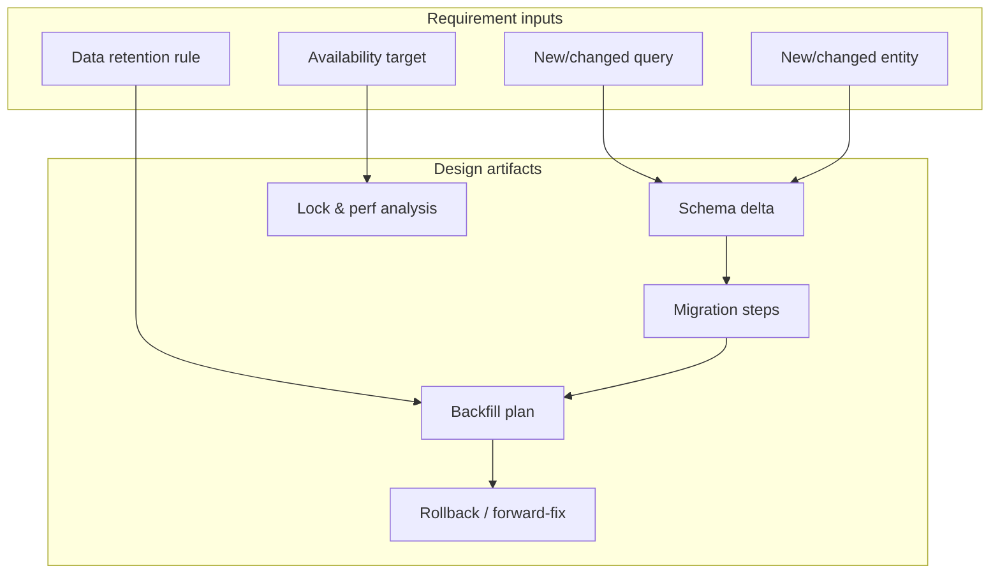
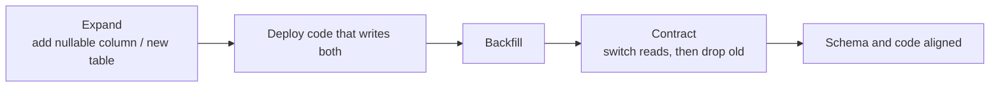
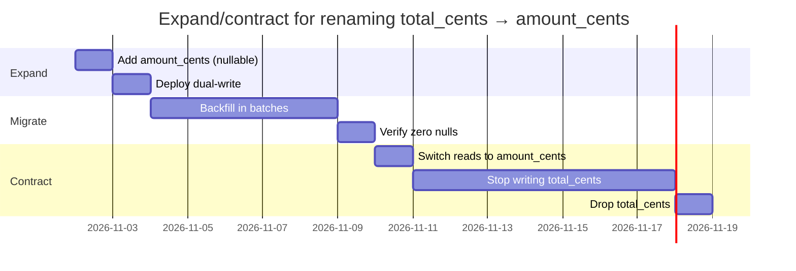
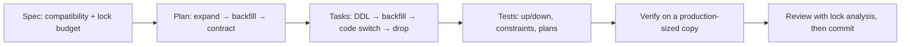
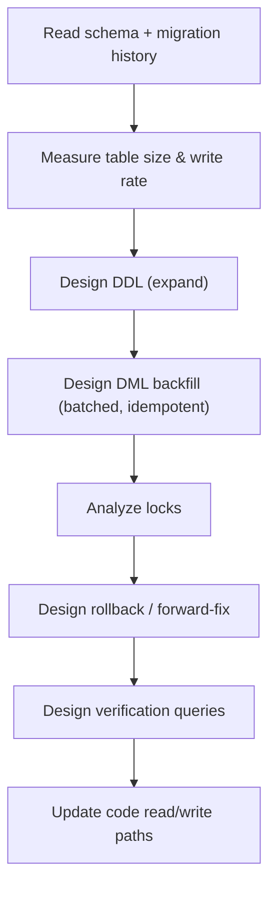
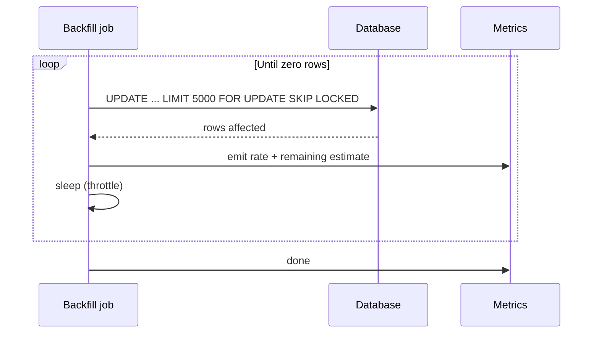
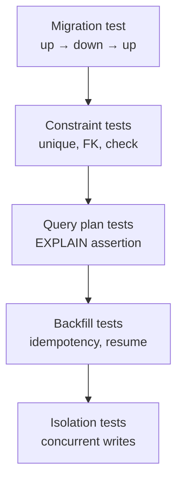
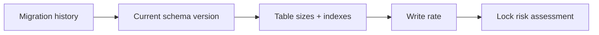
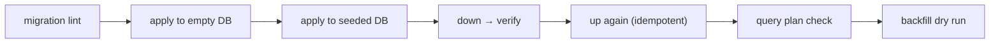

# SQL and Database Changes — SDD Guide

> Database changes are the least reversible part of most systems. This guide treats schema
> evolution as a first-class specification problem.

---

## 1. Scope

Schema design, migrations, indexing, query plans, transaction and isolation semantics, data
backfill, and rollback. Applies to PostgreSQL, MySQL/MariaDB, SQL Server, Oracle, and SQLite
with the engine-specific notes called out.



---

## 2. The compatibility contract

A schema change is a **public API change** for every consumer: application code, reports,
ETL jobs, analytics, and other services.

| Change | Backward compatible? | Notes |
| --- | --- | --- |
| Add nullable column | Yes | Safe if no `NOT NULL` without default |
| Add column with default (volatile default) | Engine-dependent | Can rewrite the table on older engines |
| Add index | Yes (but locks) | Use concurrent creation where supported |
| Add `NOT NULL` to existing column | No | Requires backfill first |
| Rename column | No | Use expand/contract |
| Change type (widen) | Usually | Verify index and constraint impact |
| Change type (narrow) | No | Data loss risk |
| Drop column | No | Use expand/contract with a deprecation window |
| Add foreign key | Usually | Validates existing rows; can lock |



### Expand/contract timeline



> **Rule:** no migration that both changes schema and rewrites data in one step on a large table.
> Separate DDL from DML.

---

## 3. Adopting SDD for database changes

There is no runtime to install. What must be installed and verified is the **migration tool** and a
**production-like database** to measure against.

### 3.1 Verify the toolchain

```bash
# Whichever the project uses
flyway -url="$DATABASE_URL" info          # Flyway
liquibase status                          # Liquibase
alembic current                           # Alembic
dotnet ef migrations list                 # EF Core

# A production-sized copy for lock and plan measurements
psql "$STAGING_DATABASE_URL" -c "SELECT pg_size_pretty(pg_total_relation_size('orders'));"
```

Never measure locking behavior on an empty local database. An index that takes 40 ms on 1,000 rows
can take 40 minutes of blocked writes on 50 million.

### 3.2 Add the agent rules

`AGENTS.md` (plus `.github/copilot-instructions.md` if your project uses Copilot in any IDE — see
[chapter 29](../docs/29-ide-setup.md)):

```markdown
## Database rules
- Separate DDL from data backfill; never rewrite a large table in one migration.
- New indexes on hot tables use CONCURRENTLY (outside a transaction).
- Never add NOT NULL to an existing column without a completed backfill.
- Renames and drops follow expand/contract with a deprecation window.
- Every migration has a tested down() or a documented forward-fix.
- Record EXPLAIN (ANALYZE, BUFFERS) evidence for every query the change depends on.
```

### 3.3 Your first SDD change



### 3.4 Verification commands

| Check | Command |
| --- | --- |
| Migration applies | `flyway migrate` / `alembic upgrade head` |
| Migration reverses | project migration test, `alembic downgrade -1`, or documented forward-fix |
| Query uses the index | `EXPLAIN (ANALYZE, BUFFERS)` |
| Dangerous patterns | `squawk migrations/*.sql` (if adopted) |
| Constraints hold | constraint-violation tests |

### 3.5 Adoption pitfalls

| Pitfall | Fix |
| --- | --- |
| Testing only on an empty database | Use a production-sized copy in staging |
| `CREATE INDEX` without `CONCURRENTLY` | Review checklist item |
| Backfill without batching | `LIMIT` + `FOR UPDATE SKIP LOCKED` |
| No rollback plan | Spec section 11 must be filled in |

---

## 4. Writing requirements

| Universal requirement | SQL addition |
| --- | --- |
| Functional behavior | Exact query semantics, ordering, null handling |
| Acceptance criteria | Row counts, constraint behavior, plan shape |
| NFRs | p95 query time, lock duration, replication lag |
| Failure scenarios | Deadlock retry, partial backfill recovery |
| Compatibility | Old and new application versions running simultaneously |

```markdown
### FR-2: Index for order export

**Acceptance criteria**
- AC-2.1 `SELECT ... WHERE project_id = $1 ORDER BY created_at DESC LIMIT 1000`
  uses an index scan after the migration (`EXPLAIN (ANALYZE, BUFFERS)` shows
  `Index Scan` or `Index Only Scan`, not `Seq Scan`).
- AC-2.2 p95 execution time ≤ 50 ms at 5M rows (measured on a production-like dataset).
- AC-2.3 The migration acquires no `ACCESS EXCLUSIVE` lock for more than 1 s.
- AC-2.4 `down()` drops the index and is tested in CI.

**Non-goals**
- Partitioning; materialized views.

**Constraints**
- PostgreSQL 16+.
- Migration tool: Flyway, versioned files, no repeatable migrations for DDL.
```

### NFR table for data changes

| ID | Target | Condition | Verification |
| --- | --- | --- | --- |
| NFR-1 | Lock < 1 s | Migration on 10M-row table | `pg_locks` observation in staging |
| NFR-2 | Backfill rate ≤ 5k rows/s | Batched update | Metrics during staging run |
| NFR-3 | Zero data loss | Any failure path | Re-run idempotent backfill test |

---

## 5. Technical plan



### Lock analysis by engine

| Engine | Operation | Lock behavior |
| --- | --- | --- |
| PostgreSQL | `ALTER TABLE ... ADD COLUMN ... DEFAULT <const>` | Metadata-only since 11 for non-volatile defaults |
| PostgreSQL | `CREATE INDEX` | Blocks writes; use `CONCURRENTLY` (outside a transaction) |
| PostgreSQL | `ALTER TABLE ... SET NOT NULL` | Full scan + `ACCESS EXCLUSIVE`; prefer a validated `CHECK` then drop it |
| MySQL 8 | `ADD COLUMN` | `INSTANT` for supported cases; verify with `ALGORITHM=INSTANT` |
| MySQL 8 | `ADD INDEX` | `INPLACE`; `LOCK=NONE` when supported |
| SQL Server | `CREATE INDEX` | `ONLINE = ON` in Enterprise |
| Oracle | `ADD COLUMN` | Fast for nullable; defaults require care pre-12c |

> **Do not guess.** Run the migration against a production-sized copy in staging and capture the
> lock wait. That is the only acceptable evidence.

### Backfill template

```sql
-- Idempotent, batched, resumable
WITH batch AS (
    SELECT id
    FROM orders
    WHERE amount_cents IS NULL
    ORDER BY id
    LIMIT 5000
    FOR UPDATE SKIP LOCKED
)
UPDATE orders o
SET amount_cents = o.total_cents
FROM batch
WHERE o.id = batch.id;
```

Run in a loop until `0 rows affected`; record progress in a control table if the dataset is large.



---

## 6. Task division

| Task | Files | Parallelizable |
| --- | --- | --- |
| Expand DDL migration | `migrations/V42__*.sql` | No |
| Dual-write code path | app + tests | After expand |
| Backfill script | `scripts/backfill_*.sql` | After expand |
| Verification queries | `scripts/verify_*.sql` | Yes |
| Read-path switch | app + tests | After backfill verified |
| Contract migration (drop) | later release | No |
| Runbook | `docs/runbooks/` | Yes |

**Definition of done:**

- [ ] Migration tested on a production-sized copy
- [ ] `down()` implemented and tested (or forward-fix documented)
- [ ] Backfill is idempotent and resumable
- [ ] Old and new app versions both work during the rollout window
- [ ] `EXPLAIN` evidence recorded
- [ ] Rollback time measured

---

## 7. Specifying tests



| Test | What it proves |
| --- | --- |
| `up` → `down` → `up` | Reversibility |
| Constraint violation test | Data integrity is enforced |
| `EXPLAIN` assertion (or plan snapshot) | Index is actually used |
| Double-run backfill | Idempotency |
| Two concurrent transactions | Deadlock/isolation behavior |
| Old app version + new schema | Backward compatibility |

```sql
-- Query plan evidence (PostgreSQL)
EXPLAIN (ANALYZE, BUFFERS, FORMAT JSON)
SELECT id, created_at, amount_cents
FROM orders
WHERE project_id = '...'
ORDER BY created_at DESC
LIMIT 1000;
```

> Plan assertions are environment-sensitive. Record the plan and the dataset size; do not assert
> on exact cost numbers across environments.

---

## 8. How the agent inspects existing code

```bash
# Migration tool and history
ls migrations db/migrate alembic 2>/dev/null
grep -rn 'flyway\|liquibase\|alembic\|doctrine-migrations' . --include='*.xml' --include='*.toml' --include='*.json' 2>/dev/null | head

# Schema definitions
find . -name 'schema.sql' -o -name '*.sql' | head -20
grep -rn 'CREATE TABLE\|CREATE INDEX' . --include='*.sql' | head -20

# Query patterns in code
grep -rn 'total_cents\|amount_cents' --include='*.py' --include='*.java' --include='*.cs' . | head -20
```



Checklist:

- [ ] Engine and version confirmed
- [ ] Migration tool and naming convention identified
- [ ] Current head revision identified
- [ ] Table size and write rate estimated
- [ ] Existing indexes on the target columns listed
- [ ] Constraint names and conventions known

---

## 9. Review focus

| Area | Question |
| --- | --- |
| Reversibility | Is `down()` real, or a no-op? |
| Locking | Which locks, for how long, on what table size? |
| Compatibility | Do old app instances still work? |
| Backfill | Batched, idempotent, resumable? |
| Rollback data loss | What data disappears if rolled back? |
| Constraints | Validated on existing data? |
| Indexes | Redundant? Unused? Covering the filter+sort? |
| Transactions | DDL inside a transaction where it cannot be? |

**High-severity SQL findings:**

- `DROP COLUMN` or destructive `down()` without a documented retention decision.
- `NOT NULL` added without backfill.
- `CREATE INDEX` (non-concurrent) on a hot table.
- Backfill without batching (`UPDATE ... SET x = y` on 50M rows).
- Migration that cannot run while old code is live.

---

## 10. Tooling and verification

| Tool | Purpose |
| --- | --- |
| **Flyway** | Versioned migrations (Java ecosystem, multi-DB) |
| **Liquibase** | Changesets with rollback support |
| **Alembic** | SQLAlchemy migrations (Python) |
| **Doctrine Migrations** | PHP |
| **EF Core Migrations** | .NET |
| **`EXPLAIN` / `EXPLAIN ANALYZE`** | Query plans (PostgreSQL) |
| **`EXPLAIN FORMAT=JSON`** | MySQL plans |
| **`SET STATISTICS IO/TIME ON`** | SQL Server |
| **pg_stat_statements** | Slow query identification |
| **Squawk** | PostgreSQL migration linter |
| **Atlas** | Schema-as-code with linting |
| **Trivy** | IaC/secret scanning |

```bash
# Example: lint a PostgreSQL migration for dangerous patterns
squawk migrations/V42__add_index.sql
```

> Tool availability varies by project. Do not add a migration linter without checking the
> project's package policy; if absent, the review checklist is the fallback.

---

## 11. CI verification



| Gate | Fails when |
| --- | --- |
| Lint | Destructive or locking anti-pattern |
| Apply up | Error on empty or seeded schema |
| Down | Fails or loses data unexpectedly |
| Re-apply | Not idempotent |
| Plan | New sequential scan on a large table |
| Backfill dry run | Not resumable |

---

## 12. Common mistakes

| Mistake | Consequence | Fix |
| --- | --- | --- |
| DDL + data rewrite in one migration | Long lock, outage | Separate steps |
| `CREATE INDEX` without `CONCURRENTLY` on hot table | Write outage | Concurrent index, outside transaction |
| No backfill batching | Lock escalation, replication lag | `LIMIT` + `SKIP LOCKED` |
| Untested `down()` | Failed rollback | Test up → down → up |
| Assuming defaults are metadata-only | Table rewrite | Verify by engine/version |
| `NOT NULL` before backfill | Migration failure | Backfill, then validate |
| Changing column type in place | Rewrite + locks | New column + backfill + switch |
| Ignoring replication lag | Stale reads during backfill | Throttle, monitor |

---

## 13. Troubleshooting

| Symptom | Cause | Action |
| --- | --- | --- |
| Migration hangs | Lock waiting on long transaction | Check `pg_locks`; cancel the blocker |
| `CONCURRENTLY` fails | Run inside a transaction | Run outside; set `autocommit` |
| Deadlocks during backfill | Conflicting update order | Order by primary key; retry |
| Index not used | Stale statistics | `ANALYZE`; check predicate selectivity |
| Replication lag spikes | Backfill too aggressive | Throttle; smaller batches |
| Constraint validation slow | Full table scan | `NOT VALID` + `VALIDATE CONSTRAINT` where supported |

---

## 14. Security considerations

| Risk | Control |
| --- | --- |
| SQL injection | Parameterized statements only |
| Over-broad DB privileges | Migrations run with DDL role; app runs with DML-only role |
| PII in backups | Encryption + retention policy |
| Row-level security gaps | Test policies explicitly per role |
| Audit trails | Append-only tables; no `UPDATE`/`DELETE` grants |
| Secrets in migration scripts | Never; use environment injection |

---

## 15. Official references

- PostgreSQL `EXPLAIN` — <https://www.postgresql.org/docs/current/sql-explain.html>
- PostgreSQL `CREATE INDEX` — <https://www.postgresql.org/docs/current/sql-createindex.html>
- PostgreSQL explicit locking — <https://www.postgresql.org/docs/current/explicit-locking.html>
- PostgreSQL transaction isolation — <https://www.postgresql.org/docs/current/transaction-iso.html>
- MySQL online DDL — <https://dev.mysql.com/doc/refman/8.0/en/innodb-online-ddl-operations.html>
- SQL Server indexes — <https://learn.microsoft.com/sql/relational-databases/indexes/>
- Oracle `ALTER TABLE` — <https://docs.oracle.com/en/database/oracle/oracle-database/23/sqlrf/ALTER-TABLE.html>
- Flyway — <https://documentation.red-gate.com/flyway>
- Liquibase — <https://docs.liquibase.com/>
- Alembic — <https://alembic.sqlalchemy.org/>
- EF Core migrations — <https://learn.microsoft.com/ef/core/managing-schemas/migrations/>
- Squawk — <https://squawkhq.com/>
- Atlas — <https://atlasgo.io/>

---

**Previous:** [PHP](./php.md) ·
**Next:** [Infrastructure as Code](./infrastructure-as-code.md)
