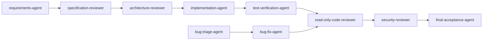

# Reusable Prompts

Each file is a role prompt you can paste into a coding agent or install as a skill.

| Prompt | Role | Writes? | Typical trigger |
| --- | --- | --- | --- |
| [master-sdd-agent.md](./master-sdd-agent.md) | Orchestrator | Yes (within mode) | "Plan and implement this feature" |
| [requirements-agent.md](./requirements-agent.md) | Requirements engineer | Spec only | "Write a spec for…" |
| [architecture-reviewer.md](./architecture-reviewer.md) | Architect reviewer | **No** | "Review this design" |
| [specification-reviewer.md](./specification-reviewer.md) | Spec reviewer | **No** | "Review this spec" |
| [implementation-agent.md](./implementation-agent.md) | Implementer | Yes | "Implement the approved tasks" |
| [bug-triage-agent.md](./bug-triage-agent.md) | Triage | **No** | "Assess this bug" |
| [bug-fix-agent.md](./bug-fix-agent.md) | Bug fixer | Yes | "Fix the confirmed bug" |
| [read-only-code-reviewer.md](./read-only-code-reviewer.md) | Code reviewer | **No** | "Review this diff" |
| [security-reviewer.md](./security-reviewer.md) | Security reviewer | **No** | "Security review this change" |
| [test-verification-agent.md](./test-verification-agent.md) | Verifier | **No** | "Verify the acceptance criteria" |
| [final-acceptance-agent.md](./final-acceptance-agent.md) | Acceptance | **No** | "Compare against the spec" |
| [review-prompts.md](./review-prompts.md) | Ten focused review prompts | **No** | Any review type, one block at a time |

## Role flow



## Common non-negotiables (present in every prompt)

```text
1. Never invent APIs, methods, configuration properties, dependencies, or commands.
2. Inspect the repository before assuming.
3. Read affected files and their callers before proposing changes.
4. Read resolved versions from the lockfile, not the manifest range.
5. Verify framework behavior against the installed version's official docs.
6. Cite file:line for repository claims; version + URL + date for external claims.
7. Never report a test, build, or scan as passed without executing it.
8. Label claims: VERIFIED / PARTIALLY VERIFIED / UNVERIFIED / CONTRADICTED.
9. When information is missing, state the unknown; do not fill gaps with invented specifics.
10. Respect the declared Git mode; never run destructive Git commands.
```

## Installing as a skill

Copy a prompt into your agent's skills directory with front matter:

```text
.github/skills/read-only-code-review/   # GitHub Copilot
.claude/skills/read-only-code-review/   # Claude Code
.agents/skills/read-only-code-review/   # Cursor, Codex, Windsurf, others
└── SKILL.md
```

The file already contains `name` and `description` front matter. Keep the `description` focused on
**when** to use the skill; that is what the agent matches on.

## Using them together

| Scenario | Prompts |
| --- | --- |
| New feature | requirements → specification-reviewer → implementation → test-verification → read-only-code-reviewer → final-acceptance |
| Bug fix | bug-triage → bug-fix → read-only-code-reviewer |
| Security-sensitive change | add security-reviewer after code review |
| Architecture decision | architecture-reviewer + ADR |
| Release | final-acceptance + release checklist ([chapter 22](../22-git-and-commit-policy.md)) |

---

**Back to index:** [00-index.md](../00-index.md)
