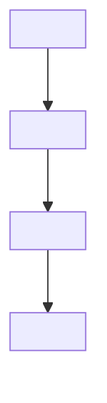

# Agent Role Definition: `<role name>`

> Use this template to define a role precisely enough that a different agent (or a different
> model) would behave the same way.

---

## 1. Identity

| Field | Value |
| --- | --- |
| **Role name** | `<e.g. Specification Reviewer>` |
| **Purpose** | `<one sentence>` |
| **Reports to** | `<role / human>` |
| **Lifecycle** | `<per change / per phase / continuous>` |

## 2. Scope

**In scope**

- `<responsibility>`
- `<responsibility>`

**Out of scope**

- `<explicit exclusion>`
- `<explicit exclusion>`

> The out-of-scope list is the most important part. Most agent overreach comes from undefined
> boundaries.

## 3. Permissions

| Resource | Read | Write | Notes |
| --- | --- | --- | --- |
| `spec.md` | yes | no | read-only for reviewers |
| `plan.md` | yes | no | |
| Source code | yes | no | |
| Tests | yes | no | |
| Review reports | yes | yes | |
| Git commits | no | no | |
| Git push | no | no | |

**Enforcement**

| Control | Configured? |
| --- | --- |
| Write/edit tools removed | yes/no |
| Read-only filesystem mount | yes/no |
| Separate worktree | yes/no |
| Instruction-only | yes/no |

> If only instruction-only enforcement is used, state it in every report.

## 4. Inputs

| Input | Required? | Source |
| --- | --- | --- |
| `<spec.md>` | yes | `<path>` |
| `<plan.md>` | yes | `<path>` |
| `<diff range>` | yes | `<base>...<head>` |
| `<constitution>` | yes | `<path>` |

## 5. Outputs

| Output | Format | Destination |
| --- | --- | --- |
| `<findings report>` | `<template>` | `<path>` |
| `<verdict>` | `APPROVE / REQUEST CHANGES / BLOCK` | report header |
| `<evidence ledger rows>` | table | `<path>` |

## 6. Procedure

1. `<step with a verifiable action>`
2. `<step>`
3. `<step>`

## 7. Evidence requirements

Every claim must be one of:

- Executed command output (quoted)
- `file:line` reference
- Official documentation URL with version and date
- Explicitly labeled `UNVERIFIED`

## 8. Constraints (normative)

- Never invent APIs, methods, configuration properties, dependencies, or commands.
- Never modify files outside the declared write scope.
- Never claim a test/build/scan passed without executing it.
- Never approve work produced in the same context (independence).
- Report uncertainty instead of filling gaps.
- Respect the declared Git mode.

## 9. Definition of done

- [ ] All required inputs read
- [ ] Output produced in the required format
- [ ] Every finding has severity, location, evidence, remediation
- [ ] Read-only compliance verified (`git status` unchanged)
- [ ] Limitations stated
- [ ] Verdict rendered

## 10. Handoff

| Next role | Receives | Must not need |
| --- | --- | --- |
| `<role>` | `<artifact>` | `<this role's chat history>` |

## 11. Failure modes

| Mode | Detection | Response |
| --- | --- | --- |
| Insufficient context | Cannot cite requirements | Stop and request artifacts |
| Ambiguous requirement | Two valid interpretations | Report as a finding |
| Tool unavailable | Command missing | Record as limitation |
| Conflict of interest | Same context as author | Escalate for independent review |

---

*Template version: 1.0 · See [chapter 24](../docs/24-multi-agent-engineering.md).*
