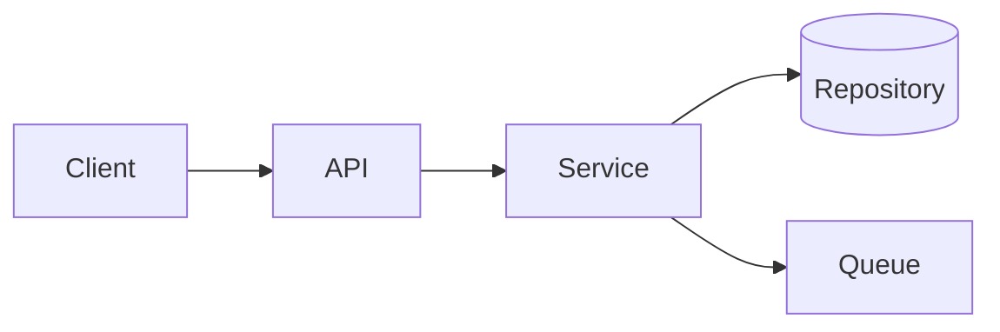
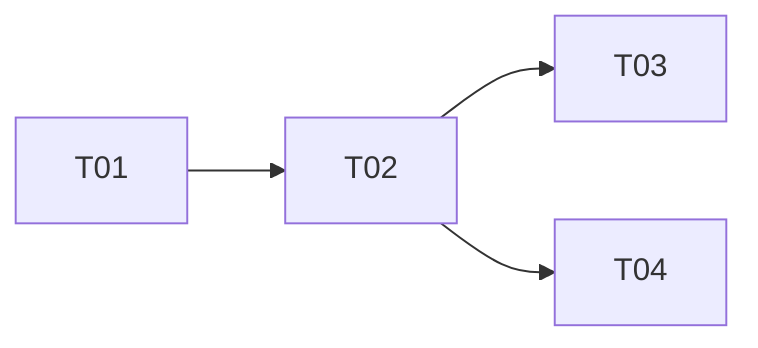

# Implementation Plan: `<change-id>`

| Field | Value |
| --- | --- |
| **Spec** | `specs/<id>/spec.md` |
| **Author** | `<name>` |
| **Status** | DRAFT / IN REVIEW / APPROVED |
| **Related ADRs** | `<ADR-n>` |

---

## 1. Summary

`<3–5 sentences: what will be built and the shape of the design.>`

---

## 2. Component boundaries

| Component | Responsibility | Owner |
| --- | --- | --- |
| `<api>` | `<HTTP, validation>` | `<team>` |
| `<service>` | `<orchestration>` | `<team>` |
| `<repo>` | `<queries>` | `<team>` |

**Boundary rules**

- `<rule>` (e.g. "handlers must not import infrastructure")

---

## 3. API contract

| Method | Path | Auth | Request | Response |
| --- | --- | --- | --- | --- |
| `GET` | `/projects/{id}/orders/export` | `viewer` | — | `text/csv` (stream) |

**Status codes**

| Code | Condition |
| --- | --- |
| 200 | success |
| 403 | no project role |
| 404 | unknown project |
| 504 | upstream timeout |

**Compatibility:** `<additive / versioned / breaking with deprecation>`

---

## 4. Data changes

### Schema

| Change | Type | Reversible | Lock impact |
| --- | --- | --- | --- |
| `<add index>` | DDL | yes | `<CONCURRENTLY>` |
| `<add column>` | DDL | yes | metadata-only |

### Migration steps

1. `<expand>`
2. `<backfill (batched, idempotent)>`
3. `<contract>`

### Rollback / forward-fix

`<Procedure, time, data loss.>`

---

## 5. Event contracts

| Event | Topic | Key | Schema | Compatibility |
| --- | --- | --- | --- | --- |
| `<export.completed.v1>` | `<orders>` | `projectId` | `<link>` | additive |

**Idempotency:** `<key derivation>`
**Ordering:** `<per-key guarantee>`
**Delivery:** `<at-least-once / exactly-once via outbox>`

---

## 6. Security design

| Concern | Design |
| --- | --- |
| Authentication | `<mechanism>` |
| Authorization | `<single enforcement point>` |
| Input validation | `<boundary + schema>` |
| Secrets | `<source>` |
| Audit | `<what/where/retention>` |

**Threat model:** `<link to chapter 21 section or threat table>`

---

## 7. Observability

| Signal | Name | Purpose |
| --- | --- | --- |
| Metric | `<orders_export_total>` | volume |
| Metric | `<orders_export_duration_seconds>` | latency |
| Log | `<correlation_id, project_id, row_count>` | diagnosis |
| Alert | `<p95 > 5s for 10m>` | page |

---

## 8. Test strategy

| Layer | Scope | Tooling |
| --- | --- | --- |
| Unit | `<logic>` | `<framework>` |
| Integration | `<DB/queue>` | `<Testcontainers>` |
| Contract | `<provider>` | `<OpenAPI/Pact>` |
| E2E | `<journey>` | `<Playwright>` |
| Performance | `<NFR-1>` | `<k6/Gatling>` |

**Test data:** `<fixtures, seeds, redaction>`

---

## 9. Task breakdown

### Phase 1 — Setup

- [ ] **T-01** `<task>` · `<FR/AC>` · files: `<paths>`

### Phase 2 — Foundational (blocking)

- [ ] **T-02** `<task>` · `<FR/AC>` · files: `<paths>` · depends: T-01

### Phase 3 — `<user story 1>`

- [ ] **T-03** `<task>` · `<FR/AC>` · files: `<paths>`

### Phase 4 — Polish

- [ ] **T-04** `<metrics/alerts/docs>` · `<NFR>`

### Parallelism

---

## 10. Risks

| Risk | Likelihood | Impact | Mitigation |
| --- | --- | --- | --- |
| `<risk>` | low/med/high | low/med/high | `<mitigation>` |

---

## 11. Definition of done

- [ ] Every AC has evidence
- [ ] Tests run and reported
- [ ] Static analysis clean
- [ ] Security scan clean or accepted
- [ ] Migration tested (up/down)
- [ ] Rollback documented
- [ ] Observability in place
- [ ] Docs updated

---

*Template version: 1.0 · See [chapter 14](../docs/14-feature-development.md).*
